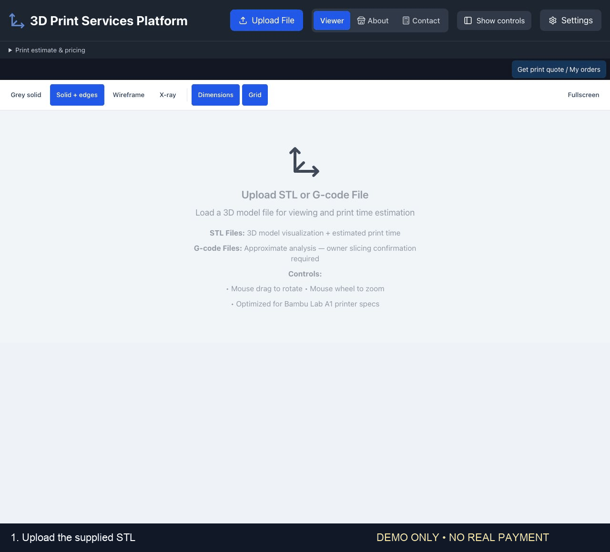
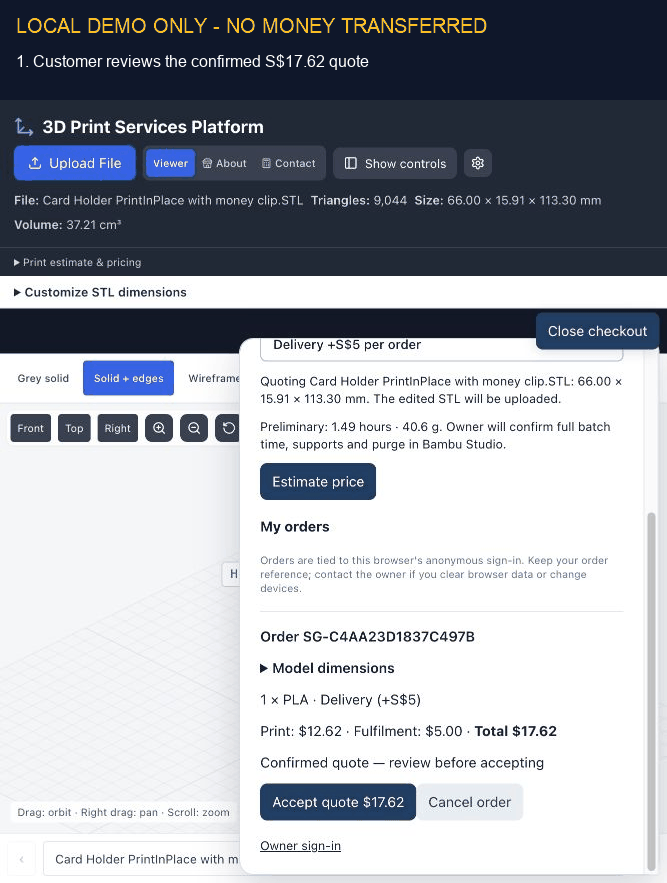

# 3D Print Services Platform

A comprehensive 3D printing platform featuring STL file visualization, print time estimation, and model management tools. Built with React, TypeScript, and Three.js, optimized for Bambu Lab A1 printer specifications.

## Customer journey demo

Watch the flow from STL upload and model inspection to a confirmed quote, PayNow instructions, manual payment verification, and an animated receipt.



This recording uses an illustrative S$15 delivery quote and simulated payment states. No payment was made and no real customer orders were changed. The QR is shown for demonstration only—do not pay it. For real orders, the owner confirms the price after slicing and verifies the bank transfer before the receipt appears.

## Resized wallet payment demo

Watch a customer accept the resized wallet's S$17.62 delivery quote, view the demo PayNow screen, submit a payment claim, and receive a receipt after manual owner verification.



This walkthrough uses only local Firebase emulator data. No money was transferred, no real customer orders were changed, and no live payment QR is included. For real orders, verify the matching transfer in your bank account before approving payment.

## ✨ Features

### 📁 File Support
- **STL Files**: 3D model visualization with interactive viewing
- **G-code Files**: Accurate print time analysis from sliced files
- **Binary STL Parser**: Custom implementation for reliable file processing

### 🎮 3D Viewer
- **Interactive Controls**: Mouse drag to rotate, wheel to zoom
- **Multi-Model Management**: Load and manage multiple models simultaneously
- **Transform Tools**: Move, rotate, scale models with precision controls
- **Build Platform**: Visual 256×256×256mm build volume representation
- **Model Operations**: Duplicate, delete, show/hide, lock/unlock models

### ⏱️ Print Time Estimation
- **Bambu Lab A1 Optimized**: Calculations based on actual printer specifications
- **Detailed Breakdown**: Outer walls, infill, travel time, and overhead analysis
- **Material Usage**: Accurate filament length, weight, and volume calculations
- **Quality Profiles**: Draft, Standard, Fine, and Ultra Fine presets

### ⚙️ Advanced Settings
- **Print Profiles**: PLA, ABS, PETG, TPU material presets
- **Speed Configuration**: Customizable print speeds for different elements
- **Advanced Parameters**: Retraction, Z-hop, combing, ironing settings
- **Real-time Updates**: Live print time recalculation as settings change

### 🎨 User Interface
- **Modern Design**: Clean, professional interface with dark/light themes
- **Responsive Layout**: Adapts to different screen sizes
- **Tabbed Settings**: Organized configuration panels
- **Visual Feedback**: Loading states, error handling, and status indicators

## 🛠️ Technology Stack

- **Frontend**: React 18 + TypeScript
- **Build Tool**: Vite
- **3D Graphics**: Three.js
- **Styling**: Tailwind CSS
- **UI Components**: shadcn/ui + Radix UI
- **Icons**: Lucide React
- **State Management**: React Context + useReducer

## 🚀 Getting Started

### Prerequisites
- Node.js (v16 or higher)
- npm or yarn

### Installation

1. **Clone the repository**
   ```bash
   git clone <YOUR_GIT_URL>
   cd stl-viewer
   ```

2. **Install dependencies**
   ```bash
   npm install
   ```

3. **Start development server**
   ```bash
   npm run dev
   ```

4. **Open your browser**
   Navigate to `http://localhost:5173`

### Build for Production
```bash
npm run build
```

## 📖 Usage

### Loading Models
1. Click "Upload File" to load STL or G-code files
2. Supported formats: `.stl`, `.gcode`, `.g`
3. Models appear in the left panel for management

### 3D Navigation
- **Rotate**: Left-click and drag (or Ctrl+drag)
- **Zoom**: Mouse wheel
- **Pan**: Model transform tools in move mode

### Print Estimation
1. Load an STL file
2. Configure print settings in the Settings panel
3. View real-time print time and material usage estimates
4. Use quality presets for quick configuration

### Model Management
- **Select**: Click on models in the viewer or model list
- **Transform**: Use Move/Rotate/Scale tools
- **Duplicate**: Create copies with offset positioning
- **Visibility**: Show/hide models individually
- **Lock**: Prevent accidental modifications

## 🏗️ Project Structure

```
src/
├── components/           # React components
│   ├── STLViewer.tsx    # Main viewer component
│   ├── SettingsPanel.tsx # Print configuration
│   ├── ModelList.tsx    # Model management
│   └── ui/              # shadcn/ui components
├── utils/               # Utility functions
│   ├── stlLoader.ts     # STL file parsing
│   ├── gcodeAnalyzer.ts # G-code analysis
│   ├── printEstimator.ts # Print time calculations
│   └── sceneManager.ts  # Three.js scene setup
├── constants/           # Configuration constants
│   └── printerSpecs.ts  # Bambu Lab A1 specifications
└── types/              # TypeScript type definitions
```

## 🖨️ Bambu Lab A1 Specifications

The platform is optimized for the Bambu Lab A1 printer with these specifications:
- **Build Volume**: 256 × 256 × 256 mm
- **Maximum Speed**: 500 mm/s
- **Maximum Acceleration**: 10,000 mm/s²
- **Nozzle Diameter**: 0.4 mm
- **Filament Diameter**: 1.75 mm

## 🔧 Configuration

### Print Settings
- **Layer Height**: 0.05 - 0.35 mm
- **Infill Density**: 0 - 100%
- **Print Speeds**: Configurable for walls, infill, and travel
- **Temperature Control**: Hotend and bed temperature settings

### Advanced Features
- **Material Profiles**: Optimized settings for different filaments
- **Quality Presets**: One-click configuration for different print qualities
- **Support Generation**: Toggle support material calculation
- **Build Plate Adhesion**: Raft and brim options

## 🚀 Deployment

### Manual Deployment
1. Build the project: `npm run build`
2. Deploy the `dist` folder to your hosting provider
3. Ensure proper MIME types for `.stl` files if serving STL files

## 🤝 Contributing

1. Fork the repository
2. Create a feature branch: `git checkout -b feature-name`
3. Commit changes: `git commit -am 'Add feature'`
4. Push to branch: `git push origin feature-name`
5. Submit a Pull Request

## 📝 Development Notes

### Local Development
- Hot reloading enabled for fast development
- TypeScript strict mode for type safety
- ESLint and Prettier configured for code quality

### Browser Support
- Modern browsers with WebGL support required
- File API support for local file loading
- ES2020+ JavaScript features used


## CAD-style STL inspection

The STL workspace uses neutral grey shading with sharp-edge outlines. Blue edges
identify the selected part. Front, top, right and fit-isometric controls use
orthographic projection; drag to orbit, right-drag to pan, and scroll to zoom.
Choose **Move** for dragging a part on the bed, then **Orbit / select** to resume
camera rotation. Numeric rotation and scale controls remain available.

Dimension callouts show the selected part's **world-aligned overall bounds**:
width, depth and height. They update after transforms and disappear when the part
is hidden or deleted. STL coordinates are assumed to be millimetres; these are
mesh bounds, not CAD feature measurements. The display uses Y-up internally and
converts STL Z-up geometry when placing it on the printer bed.

Design references: [three-cad-viewer](https://github.com/bernhard-42/three-cad-viewer)
(separate surfaces/edges and preset cameras) and
[chili3d](https://github.com/xiangechen/chili3d) (orthographic camera and target-based
navigation). Neither library is added as a dependency. STEP/CAD inspection is deferred.

Verification:

- `npm test` checks model placement, duplication, reset, selection and scale validation.
- `npm run build` builds the application.
- With `npm run dev` running, open `/tests/viewer.html` for browser/WebGL checks of
  camera fitting, zoom, dimension updates, resize and cleanup. The page title reports PASS or FAIL.

## Singapore pricing and PayNow checkout

The checkout implementation is on `codex/singapore-checkout`. The viewer keeps
models local until the customer explicitly requests a quote. Checkout uploads
only the selected transformed part as STL; quantity is entered separately.
Opening a file or adjusting the camera never uploads it.

### Local demo

Requirements: Node 22, Java 21+, npm. The repository pins a local Node 22 runtime
for emulator commands. On macOS the wrapper detects Homebrew OpenJDK 21; elsewhere
put Java 21 on PATH. Install both dependency sets:

```sh
npm ci
npm --prefix functions ci
npm --prefix functions run build
npm run dev:emulator
```

In another terminal, seed **only the running local emulators**, then start Vite:

```sh
FIRESTORE_EMULATOR_HOST=127.0.0.1:8088 \
FIREBASE_AUTH_EMULATOR_HOST=127.0.0.1:9099 \
FIREBASE_STORAGE_EMULATOR_HOST=127.0.0.1:9199 npm run seed:emulator
VITE_CHECKOUT_MODE=emulator npm run dev -- --host 127.0.0.1 --port 8083
```

Open http://127.0.0.1:8083. Use “Get print quote / My orders”. The `/owner` route
uses synthetic credentials in the ignored `.emulator-seed.json` file. The seed
script rejects non-local emulator hosts. No real PayNow account or payable QR is
seeded. Emulator data is temporary; restart/seed resets the demo. Owner credentials
are regenerated by each seed. Do not use real customer data in this demo.

The default `VITE_CHECKOUT_MODE=disabled` prevents checkout connections. Emulator
mode uses `demo-print-checkout` and connects Auth, Firestore, Functions and Storage
only to localhost. The legacy Firebase configuration is retained for unrelated
existing application features; the viewer's background cloud uploads were removed.

### Business calculations

Starter costs: S$0.3116/kWh including GST (1 Oct–31 Dec 2026); provisional 150 W
average power; PLA S$25/kg; printer S$700; 3,000-hour recovery life; maintenance
S$0.20/hour; handling 15 minutes at S$15/hour; S$1 packaging; 10% reserve on material,
energy, depreciation and maintenance. These are editable owner settings. The
average power is **not** the printer's peak rated power. Use actual bill/meter data.
Expired tariffs display a warning rather than changing historic prices.

Print charge is the greater of S$10 or full job cost divided by (1 − target margin),
with a starting 40% margin. Free collection or S$5 delivery is charged once per
order. Courier expense is separate: charging S$5 does not guarantee the courier
costs S$5. Actual-cost records replace estimated values; failed-print expense
replaces the reserve instead of being charged twice. Partial records are labelled.
All money is calculated with fixed-point decimal arithmetic and stored in cents.

The geometry estimate is preliminary. The owner must inspect the STL and confirm
whole-batch hours, filament (including supports/purge) and occupied build bounds
from Bambu Studio. Each bound must be within the A1's 256 × 256 × 256 mm envelope.
Confirmed batch totals are not multiplied by quantity. Changed model/settings
clear the current preview; an existing order remains a separate immutable request.

### Customer and owner flow

1. Customer loads an STL, chooses quantity and collection/delivery, reviews an
   estimate and submits contact details. Delivery requires a six-digit SG postal
   code. This submission deliberately uploads the selected transformed STL.
2. Owner downloads, inspects and slices it, then confirms batch totals and price.
3. Customer accepts that quote version. Only then are configured payment details
   shown. Static QR instructions require entering the amount and order reference.
4. “I've paid” means **awaiting verification**. Owner checks the bank receipt and
   records its unique bank transaction reference to mark Paid, or rejects with a
   reason. The app does not contact a bank or transfer funds.
5. Only paid orders can enter printing. Ready orders branch to collected or
   dispatched. A paid cancellation before printing requires a manually recorded
   refund; recording a refund does not send one. Pending payment claims must be
   resolved before cancelling or revising a quote.
6. Owner records actual material/time, handling, failed-print and courier expense
   to compare estimated and actual profit. Completed records can be marked final.

Anonymous Firebase Auth ties orders to the customer's browser session. Reloading
recovers orders, but clearing browser data or changing devices does not. Customers
should retain their reference and contact the owner for manual recovery. This
release does not offer email recovery, bank webhooks, courier booking or GST sales.

### Access controls and live setup

Customer documents contain public prices only. Private costs, settings and audit
records use separate documents. Client writes to order/configuration documents are
denied, including for owners; callable functions validate authentication, owner
claims, versions, state transitions and idempotency keys. Prices are recalculated
on the server. Immutable model uploads are restricted to the authenticated user's
path, with size and STL content validation before order association.

Live operation requires a **separate authorized deployment**. Nothing here was
deployed or enabled in the existing Firebase project. Before deployment, configure
a dedicated Firebase project and the `VITE_CHECKOUT_*` environment variables from
`.env.example`, deploy the reviewed rules/functions, provision an owner account and
set its `owner: true` custom claim through a trusted Admin SDK process. Customers
cannot grant themselves that claim. Configure the actual business/recipient name,
PayNow mobile/UEN or bank-issued PNG/JPEG QR, recipient-match confirmation, and
collection instructions. Declare non-GST status and explicitly enable live
checkout. Unknown or GST-registered status blocks live setup in this release.
Verify real banking details and complete a controlled real-order check before
accepting public orders. Bank matching remains a human responsibility.

### Verification

Run automated checks with no other emulators occupying the ports:

```sh
npm test
npm run test:emulator
npx playwright install chromium
npm run test:e2e
npm run build
npm --prefix functions run build
npm --prefix functions run typecheck
npx tsc --noEmit -p tsconfig.app.json
npm run lint
```

The emulator integration checks exercise real callables/rules and synthetic STL
uploads. Browser tests exercise desktop and narrow viewer checkout through manual
owner verification. Browser screenshots go to ignored `test-results/`. Existing
unrelated lint failures are listed in the implementation handoff; do not treat a
failing repository lint command as a passing check.

Verified implementation checks (18 Oct 2026): 14 unit tests, 2 emulator integration
suites and 2 desktop/narrow end-to-end browser tests pass. Frontend/backend builds
and TypeScript checks pass. Repository lint still reports its 14 pre-existing
errors (settings components, ui/command, ui/textarea, AppContext and Tailwind
configuration); this change introduces no lint errors. The independent review's
receipt reuse and actual-cost reload findings were reproduced and fixed.
Bank transaction references are unique across this single-merchant installation,
so changing QR images or PayNow identifier formatting cannot reuse a receipt.

### Production checkout (Task-list shared project)

The Vercel production site uses `task-list-6a69a` with a dedicated protected
Storage bucket, `task-list-6a69a-print-checkout`, and Firestore in Singapore.
The legacy default bucket and its existing rules are not part of checkout.
Use `npm run deploy:checkout` for backend updates; do not deploy the default
`firebase.json` storage configuration into this shared production project.
Set `CHECKOUT_STORAGE_BUCKET=task-list-6a69a-print-checkout` in the ignored
`functions/.env.task-list-6a69a` before deploying. Client configuration is managed
in Vercel's production `VITE_CHECKOUT_*` variables.

Owner access is granted through a server-side custom claim. At `/owner`, enter
your approved email and use **Set or reset password** to set a password through
your inbox. Never share the password. Confirm the sliced quote first; customers
then accept it, scan the bank-issued QR, enter the exact total and use the order
reference. Their payment claim remains pending until you match the amount and
reference against your bank transactions and approve it in the dashboard.

### STL dimension customization

Open **Customize STL dimensions** after uploading an STL. Enter overall X/Y/Z dimensions in millimetres, apply the change, and use **Download edited STL** to save the same binary snapshot sent with a quote request. Proportions are locked by default; independent scaling changes holes, walls and clearances too. Relocking preserves the customized proportions. Dimensions follow the original model axes; placed build dimensions are shown separately. An oversize model can be downloaded, but must fit the A1's 256 × 256 × 256 mm volume before quoting.

Submitted orders retain their original STL snapshot. Customers and the owner can open **Model dimensions** to review the source filename and original/edited sizes. G-code remains read-only analysis; upload the original STL for customization and quoting. Owner slicing and manual PayNow verification are unchanged.

Photo references were removed from this release at the owner's request. Existing stored data is not deleted. Deploy the compatible checkout Functions before the frontend using `npm run deploy:checkout`; do not alter the shared project's legacy bucket rules. Automated checkout tests use the `demo-print-checkout` emulators, never real orders.
